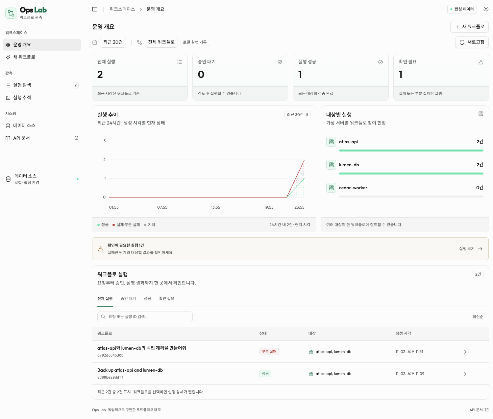
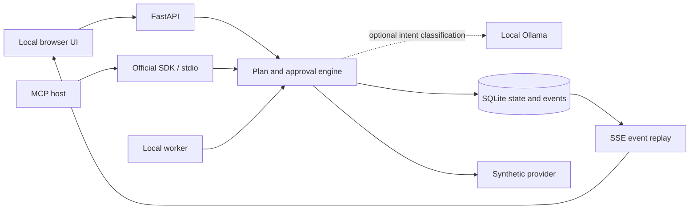

# Ops Workflow Lab

[한국어](docs/README.ko.md) · [My contribution & case study](docs/case-study.md) · [Grounded graph demo](docs/grounded-workflows.md) · [Local LLM & evaluation](docs/local-llm.md) · [Architecture](docs/architecture.md) · [Design decisions](docs/design-decisions.md) · [Public-release scope](docs/public-release.md)

A runnable operations-agent portfolio demo: review a plan, approve simulated changes, and follow every execution step in a durable event timeline.

**All infrastructure and operation results are synthetic.** Choose a deterministic baseline, local intent classification, or a **LangGraph RAG pipeline** using a real local Ollama LLM and embedding model. Model intent is validated before server-owned steps are built; simulated changes still require human approval. No cloud credentials are needed.

> Independent demonstration implementation. No company source code, product API contracts, internal runbooks, credentials, customer data, or original Git history are included.



The Korean UI uses a desktop observability dashboard: grouped navigation, metric cards, measured run trends, target participation and a searchable execution table. New requests open in a modal; selecting a run opens a right-hand inspector with a step tree, cited evidence, plan JSON and events. Light and dark themes are included. Earlier v0.1 screenshots remain as historical references.

## Run locally

Requires Python 3.11+ and [uv](https://docs.astral.sh/uv/).

```sh
git clone https://github.com/jechoiyyy/ops-workflow-lab.git
cd ops-workflow-lab
uv sync --frozen --extra dev
uv run ops-lab
```

Open **http://127.0.0.1:8765**. The server binds to loopback. Run state is stored in the ignored `.data/lab.db` file and survives restarts. Dependencies are downloaded during setup; the running demo does not need internet access.

For a separate workspace: `uv run ops-lab --port 8766 --db .data/second.db`.

### Use your local Ollama model

```sh
ollama list
uv run ops-lab --planner ollama --model qwen3.8:27b-ctx32k
```

The example is a locally installed model tag used for this demo's evaluation; replace it with an exact name from your own `ollama list`. Ollama must already be running with the model installed. The application does not download models or fall back to rules when inference fails.

Try **“atlas-api 서버를 백업해 두고 싶어. 계획을 만들어줘.”** The UI displays the model, structured interpretation, latency, and execution trace. The local model classifies intent; it does not generate executable code, choose arbitrary tools, or approve changes. [Setup, evaluation evidence, and limitations](docs/local-llm.md).

### Grounded multi-target workflow

```sh
uv run ops-lab --planner rag --model qwen3.8:27b-ctx32k --embedding-model bge-m3:latest
```

Both model tags must already be installed. Try **“Back up atlas-api and lumen-db”**, select **재시도 한도 소진**, then build the plan. Open **근거** to review the retrieved synthetic runbooks and cited controls. Approve once: the first target exhausts its retry budget, the second completes, and the final join reports `partial_failure`. Cancel stops remaining work while retaining completed receipts.

[Walkthrough, evaluation and limits](docs/grounded-workflows.md) · [Contribution narrative and reviewer guide](docs/case-study.md)

## Try a two-minute walkthrough

1. Enter **Back up atlas-api** and select **한 번 실패한 뒤 재시도 성공**.
2. Build the execution plan. All tool attempts remain at zero while approval is pending.
3. Review the target, scenario, and three planned steps, then approve.
4. Watch the synthetic snapshot fail once, retry, and pass verification. Expand the JSON result to inspect the receipt.
5. Create another plan and reject it, or choose **재시도 한도 소진** to inspect a controlled failure.

| Example request | What happens |
| --- | --- |
| `Show inventory` | Reads three fictional servers; no approval required |
| `Back up atlas-api` | Inspects a fictional server, creates a simulated snapshot, verifies it |
| `Rehearse recovery for lumen-db` | Creates and verifies a simulated sandbox after approval |
| `atlas-api 백업해줘` | Korean equivalent of the backup request |
| `lumen-db 복구 리허설해줘` | Korean equivalent of the rehearsal request |

Targets are `atlas-api`, `lumen-db`, and `cedar-worker`. Rule mode accepts explicit example commands. Basic Ollama mode accepts one target; RAG mode accepts one operation across up to three explicitly named targets. Unknown or ambiguous requests should be rejected. See the live evaluation for the measured limits of that behavior.

## What this demonstrates

- **Approval bound to a plan:** a SHA-256 digest covers the target, action, steps, and failure scenario. Execution checks the recorded approval again.
- **Idempotent requests:** a unique request key returns the original run on retry. Reusing it with different input returns a conflict.
- **Transactional progress:** a simulated operation receipt, step result, and completion event commit together in SQLite.
- **Bounded failure handling:** transient errors retry up to three total attempts; integrity failures stop immediately.
- **Restart and replay:** completed steps are preserved, queued work resumes, and SSE reconnects use persisted event sequence numbers.
- **MCP interface:** a real stdio server exposes synthetic inventory, proposal, status, and event tools. It does not expose an approval tool.
- **Grounded graph:** LangGraph target fan-out, local dense retrieval, citation/required-control validation, one bounded repair, server-owned execution DAG and per-target result aggregation.
- **Local model integration:** Ollama JSON-schema output, strict response validation, target grounding, explicit timeout/error behavior, and opt-in live evaluation on synthetic requests.

## Architecture at a glance



The browser/API and MCP share the application engine and database. The browser's worker executes queued runs. The internal simulator is called directly; the browser does **not** call the simulator through MCP. See [architecture and boundaries](docs/architecture.md).

## Connect an MCP client

Keep the UI server running. Configure a stdio client using the same checkout and database:

```json
{
  "mcpServers": {
    "ops-workflow-lab": {
      "command": "uv",
      "args": ["--directory", "/absolute/path/to/ops-workflow-lab", "run", "ops-lab-mcp"]
    }
  }
}
```

The placeholder path must point to your checkout. If the UI uses a custom database, set the same absolute `OPS_LAB_DB` environment variable in both processes. Available tools: `list_demo_targets`, `propose_workflow`, `get_workflow`, `get_workflow_events`. Refresh the UI's recent-runs list to review a proposal created by an MCP host. Human decisions are made in the local UI/API.

For the grounded graph, use `OPS_LAB_PLANNER=rag`, `OPS_LAB_MODEL=<installed tag>` and optionally `OPS_LAB_EMBEDDING_MODEL=bge-m3:latest`.

MCP defaults to rule mode independently of the web process. To use local inference there too, add `OPS_LAB_PLANNER=ollama` and `OPS_LAB_MODEL=<your installed tag>` to the MCP server's environment.

The dependency is deliberately constrained to the supported MCP SDK 1.x API, with an exact resolution in `uv.lock`. [Official SDK documentation](https://py.sdk.modelcontextprotocol.io/v1/).

## Validate

```sh
uv run pytest -q
uv run ruff check .
uv run ruff format --check .
python3 scripts/check_public_export.py
```

Tests cover the approval boundary, contradictory decisions, concurrent duplicates, bounded retries, restart recovery, transactional rollback, event replay, HTTP validation, and a real MCP subprocess handshake/tool call.

The local [API reference](http://127.0.0.1:8765/docs) and [OpenAPI schema](http://127.0.0.1:8765/openapi.json) are served without CDN assets.

## Scope and limitations

This is an independently implemented **portfolio demonstration**, not an anonymized production release or a performance benchmark. It contains no actual backup, recovery, cloud provisioning, or product-specific implementation. The read-only inventory and verification outputs are simulated too.

The LLM classifies intent and, in RAG mode, selects cited controls from an original eight-document synthetic corpus. The server owns the execution tools and dependencies. Retrieval chooses runbooks, not arbitrary tools. Local inference is serialized; graph branches are logically independent, not concurrent cloud operations. Planning state is in memory; only completed proposals and subsequent execution are durable. The application is local and single-user, with no authentication or multi-tenant authorization. Its approval gate demonstrates a workflow invariant; it does not authenticate the human making the HTTP request. Do not expose it as a public service without adding those controls.

SQLite serializes the demo's immediate tool operations. The atomicity guarantees apply to these in-process simulations, not to real remote infrastructure. External adapters would need remote idempotency, leases, timeouts, and reconciliation. See the [design tradeoffs](docs/design-decisions.md).

## License

MIT for this independently authored demo. Third-party packages retain their own licenses. Bundled Outfit and Noto Sans KR fonts use SIL OFL 1.1; see [asset sources and licenses](docs/third-party-assets.md).
