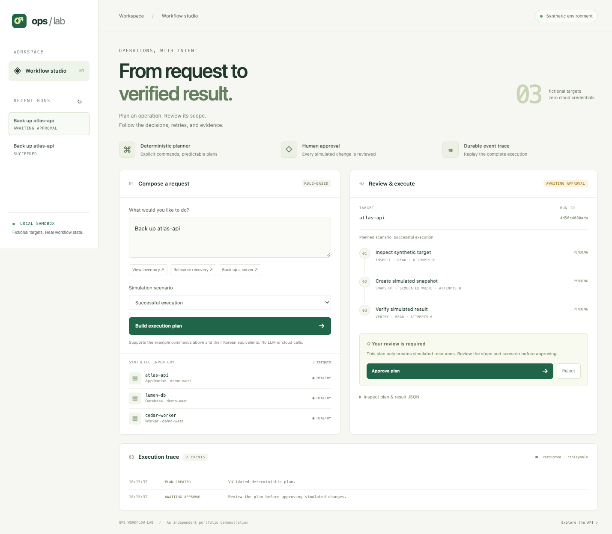

# Ops Workflow Lab

**요청 → 계획 → 사용자 승인 → 실행 → 검증** 흐름을 직접 실행해 볼 수 있는 운영 에이전트 포트폴리오 데모입니다.

회사 소스코드나 제품 API를 옮기지 않고 범용적인 워크플로 설계를 별도로 구현했습니다. 모든 서버·리소스·실행 결과는 가상 데이터이며, 요청 해석은 LLM 대신 명시적인 명령 규칙을 사용합니다.



## 실행

Python 3.11 이상과 [uv](https://docs.astral.sh/uv/)가 필요합니다.

```sh
git clone https://github.com/jechoiyyy/ops-workflow-lab.git
cd ops-workflow-lab
uv sync --frozen --extra dev
uv run ops-lab
```

브라우저에서 http://127.0.0.1:8765 를 엽니다. 설치 이후에는 API 키나 클라우드 계정, 인터넷 연결 없이 실행됩니다. 실행 상태는 Git에서 제외한 `.data/lab.db`에 저장됩니다.

## 확인할 시나리오

1. `atlas-api 백업해줘`를 입력합니다.
2. **Timeout once, then recover**를 선택하고 계획을 생성합니다.
3. 승인 전에는 모든 단계의 실행 횟수가 0임을 확인합니다.
4. 대상을 확인하고 승인하면 조회 → 모의 스냅샷 생성 → 검증을 실행합니다.
5. 스냅샷 단계의 첫 시도는 실패하고, 두 번째 시도는 성공합니다. 이벤트 기록과 JSON 결과에서 확인할 수 있습니다.

`서버 목록 보여줘`는 승인 없이 조회합니다. `lumen-db 복구 리허설해줘`는 가상의 복구 환경을 만드는 시나리오입니다. 임의의 자연어, 실제 서버 이름, 여러 작업을 묶은 요청은 지원하지 않습니다.

| 설계 주제 | 구현 및 확인 방법 |
| --- | --- |
| 승인과 계획의 결합 | 대상·작업·단계·실패 시나리오의 해시를 승인에 연결. 다른 해시를 보내면 409 |
| 중복 실행 방지 | 동일한 요청 키는 동일한 실행을 반환. 다른 본문으로 재사용하면 충돌 |
| 실행 상태 보존 | 모의 도구 결과·영수증·완료 이벤트를 SQLite 트랜잭션으로 기록 |
| 실패 처리 | 일시 실패는 최대 3회 시도. 검증 실패는 즉시 종료 |
| 재시작 대응 | 완료한 단계를 유지하고 대기·실행 중 작업을 이어서 진행 |
| 관측 가능성 | SSE 실시간 이벤트와 순서 번호 기반 재전송 |
| MCP | 공식 Python SDK의 stdio 통신으로 계획 제안·조회 도구 제공 |

MCP 도구에는 승인 기능이 없습니다. MCP에서 제안한 계획은 같은 DB를 사용하는 로컬 UI/API에서 검토하고 승인합니다. 브라우저는 MCP를 거치지 않고 공통 실행 엔진을 직접 사용합니다.

## 테스트

```sh
uv run pytest -q
uv run ruff check .
uv run ruff format --check .
python3 scripts/check_public_export.py
```

동시 요청, 승인 전 실행 차단, 승인 거절, 재시도 소진, 재시작 복구, 이벤트 재전송, MCP 실제 프로세스 통신을 검증합니다.

## 포트폴리오 범위

이 저장소에서 보여주는 것은 **작업 상태·승인·재시도·검증·이벤트 기록을 연결하는 설계와 구현**입니다. 원본 상용 시스템의 공개본, 실제 백업 엔진, LLM 성능 평가 결과가 아닙니다. 실제 제품 API·운영 문서·고객 데이터·기존 Git 이력을 포함하지 않습니다.

로컬 단일 사용자 데모이며 사용자 인증은 없습니다. 승인 상태 검사는 워크플로의 제약을 보여주지만 HTTP 호출자의 신원을 검증하지는 않습니다. 외부 서비스로 운영하려면 인증·권한, 분산 작업 제어, 원격 작업의 멱등성·시간 제한·상태 재조정이 필요합니다.

[상세 아키텍처](architecture.md) · [설계 선택과 한계](design-decisions.md) · [공개 범위](public-release.md) · [English README](../README.md)
