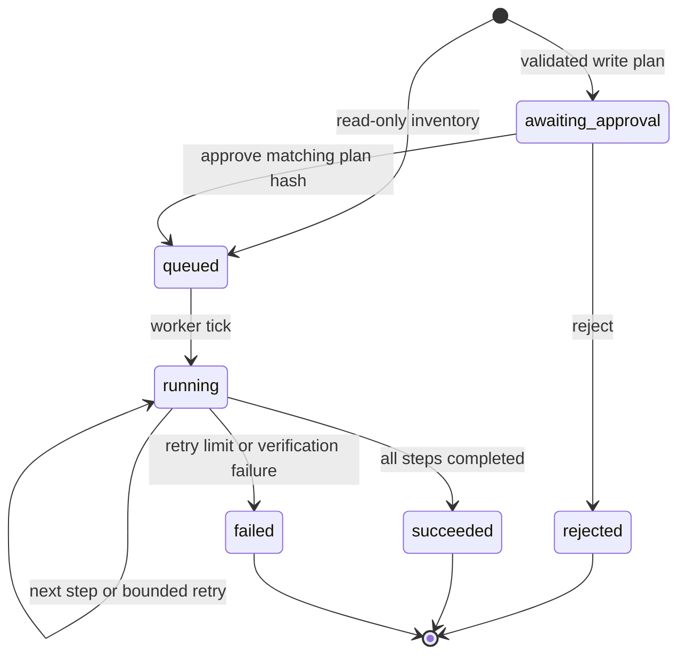

# Architecture

The repository has one application engine, two input interfaces, and an entirely synthetic provider. It is intended to be inspectable in one sitting.

| Module | Responsibility |
| --- | --- |
| `planner.py` | Validate a narrow command grammar and produce an immutable plan digest |
| `engine.py` | Bind approval to a plan, enforce idempotency, advance steps, bound retries |
| `store.py` | Persist runs, steps, operation receipts, and ordered events |
| `provider.py` | Return fictional inventory and simulated results; inject deterministic failures |
| `server.py` | Local HTTP API, background worker, SSE replay, static UI |
| `mcp_server.py` | Official SDK stdio interface for proposing and observing runs |
| `static/` | Browser interface without a build step, CDN, fonts, or analytics |

## State transitions

Pending write plans execute **zero tools**, including the inspection step. Rejection marks the planned steps skipped. Approval is idempotent; the opposite decision is rejected once a decision is recorded. There is no post-approval cancellation endpoint in this demo.

## One execution tick

1. Acquire SQLite's write transaction with `BEGIN IMMEDIATE`.
2. Load the persisted run and check its approval hash.
3. Select the first pending/retrying step and increment its attempt count.
4. Look for an existing operation receipt, otherwise call the synthetic provider.
5. Record either a retry/failure, or the receipt and successful step result.
6. Append events and commit. A rollback discards the partial tick.

The operation key derives from the run ID, step position, and plan hash. Separate runs intentionally create separate simulated resources. Request keys identify client retries, not globally equivalent goals.

Each tick is short and runs in a worker thread. A single loop visits ready runs with a 650 ms pause between passes, making the demo trace readable. This is fixed-interval retry scheduling, not exponential backoff. The attempt budget is persisted, so restarting does not reset it.

## Event delivery

Events have an increasing, database-wide sequence number. A run's sequence can have gaps when other runs write events. Clients request events strictly after their cursor and deduplicate by sequence. SSE supports both the `after` query and `Last-Event-ID` header, drains a possible terminal-event race, then sends a `done` snapshot. This is durable replay with possible transport redelivery, not an exactly-once network delivery guarantee.

## MCP boundary

The stdio process registers four tools with the official MCP Python SDK. It shares the engine and database with the HTTP process, but does not start a worker or expose an approval function. A running UI server performs execution; proposals can still be stored while it is stopped. The user refreshes recent runs to discover proposals created by another client.

MCP is an input interface here. The application worker calls `SyntheticProvider` directly; it does not make an MCP round trip for each simulated operation.

## Local-service boundary

The CLI binds to `127.0.0.1`; the web layer restricts hostnames and cross-origin browser requests. Static assets are local, CSP prohibits external dependencies, and the UI uses text nodes for all response content. These choices reduce accidental browser exposure. They are not user authentication: other local programs can access the API and database.
