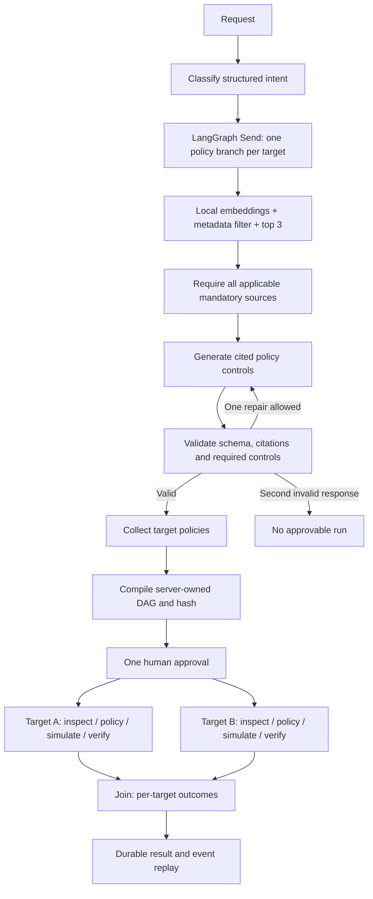

# Grounded multi-target workflows

RAG mode connects actual local inference to evidence validation and a durable synthetic execution DAG. All runbooks were authored for this demo. None describe real infrastructure procedures.

```sh
ollama list
uv sync --frozen --extra dev
uv run ops-lab --planner rag --model qwen3.8:27b-ctx32k --embedding-model bge-m3:latest
```

Use exact installed model tags. No downloads, cloud fallbacks or external model APIs are triggered. Open `http://127.0.0.1:8765` and try `Back up atlas-api and lumen-db`, or `lumen-db와 cedar-worker의 복구 리허설 계획을 만들어줘`.

## Planning and execution



Inventory takes a direct read-only path and does not retrieve policies. All model calls have a 120-second per-call timeout. The policy graph has at most two generation attempts per target. Schema/transport failures are explicit service errors rather than automatic rule fallback. Semantic policy errors receive one repair with validation feedback. Missing required evidence stops planning before policy generation.

Logical target branches use LangGraph `Send`; `max_concurrency=1` serializes local inference. Execution advances one ready step per tick in SQLite. The graph depicts dependency independence, not simultaneous GPU or remote infrastructure work.

The original corpus has eight documents including a retired distractor. Action, role and active status filter eligibility before cosine ranking. Document vectors are cached in process; a restart rebuilds them. Evidence text, citations and the corpus hash are bound to the approved plan. Controls are simulated receipts, not executable database or cloud commands.

## Dashboard walkthrough

The interface is Korean. Use **새 워크플로** to open the request modal; select a table row to open the right-side inspector. The left step tree selects the tool result shown in **실행 결과**.

- Metrics and the searchable/filterable table use the latest 30 real local demo runs. Empty data stays empty; there are no invented traffic, cost or production metrics.
- **실행 결과** shows target outcomes, dependency IDs, attempts and the final join.
- **근거** links every selected control to the retrieved synthetic source and shows generation/validation records. Scores are cosine similarities, not confidence probabilities.
- **계획 JSON** exposes the full artifact, hash, corpus identity and recorded step results.
- **계획 승인** releases the whole plan once. **거절** executes no steps. **남은 작업 취소** preserves already committed receipts and skips remaining work; it does not roll back completed operations.
- A non-success simulation affects the **first named target only**. Other targets continue and the final status can be `partial_failure`.

Planning records appear after the full proposal completes. They are not token streaming or resumable planning checkpoints. The execution timeline is persisted and replayable. A process interruption during planning requires a new planning attempt; an interruption after persistence resumes the execution state.

## Evaluation

```sh
uv run python scripts/evaluate_grounded.py --model qwen3.8:27b-ctx32k
```

The checked-in [report](evaluation-grounded.json) records **8/8 development smoke cases**: English multi-target backup with partial failure, Korean multi-target rehearsal, single-target backup with retry, inventory, and four unsupported requests. Accepted policy cases passed source/control checks with one generation attempt per target. Measured planning times in that run were 5.9–10.4 seconds for policy workflows and 1.8 seconds for inventory. These are individual local observations, not latency percentiles or a throughput benchmark.

Required-document coverage at three was 1.0 for the five planned target policies. This is a weak retrieval test: metadata filtering leaves only one or two eligible documents per target, fewer than the cutoff. It verifies wiring and coverage, not ranking quality. A future comparison should add many applicable distractors, a held-out query set, lexical/dense baselines and ranking metrics before making quality claims.

`tests/test_grounded.py` executes the actual LangGraph topology with deterministic model/embedding doubles to test missing sources, fabricated citations, dropped targets, one-repair success and two-attempt rejection, approval gating, branch isolation, restart and cancellation. The live report supplements those tests; it does not replace them or prove rejection for every adversarial prompt. No production infrastructure was exercised.

The earlier `evaluation*.json` intent reports describe the v0.1 single-target classifier. They remain historical evidence and should not be combined with this dataset into one accuracy score.
