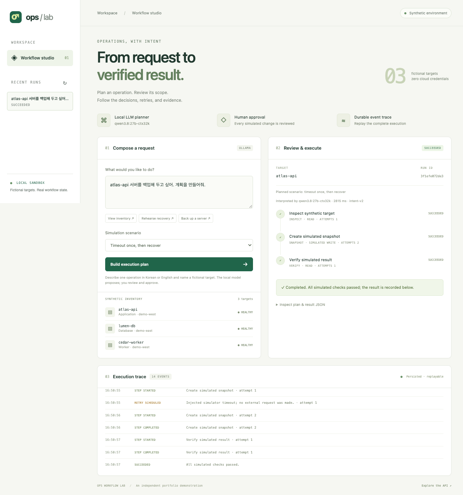

# Local LLM demo and evaluation

The optional model interprets a request into `{disposition, action, target}`. The server validates this JSON, requires an explicitly named fictional target for write operations, and constructs a fixed plan. Human approval is still required. Tool execution is simulated; model inference is real.



## Start

```sh
ollama list
uv run ops-lab --planner ollama --model qwen3.8:27b-ctx32k
```

Use an exact locally installed tag. The tag above was present on the evaluation machine; it is not a promise that the same tag exists in a public model registry. Models are not downloaded automatically. The default Ollama origin is `http://127.0.0.1:11434`; `--ollama-url` accepts another loopback HTTP origin. Proxies and HTTP redirects are disabled for inference.

Try `atlas-api 서버를 백업해 두고 싶어. 계획을 만들어줘.` or `Could you prepare a recovery rehearsal for cedar-worker?`. The UI indicates Ollama mode and shows the model name, planning latency, and structured interpretation in the result JSON. The planning call is synchronous with a 120-second timeout; the execution trace starts after the plan is persisted. This is not token streaming.

## Contract and failure behavior

- Model output is constrained with Ollama's JSON-schema `format` and validated again by a strict Pydantic model. Extra fields such as `approved` and unknown actions are rejected.
- The model never supplies executable steps. Only inventory, synthetic backup, and synthetic rehearsal are available.
- No inference is repeated for a request key that already has a persisted run.
- Missing targets, multiple targets, unsupported semantics, and malformed model output create no run. Semantic rejection depends partly on the model and is not a universal guarantee; review the returned plan.
- Model errors return explicit errors, with no silent fallback to deterministic parsing.
- `GET /api/health` reports the configured planner/model; it does not perform an inference readiness check.
- For MCP inference, set `OPS_LAB_PLANNER=ollama` and `OPS_LAB_MODEL` on the stdio process. The web and MCP planner settings are independent.

Implementation follows the official [chat API](https://docs.ollama.com/api/chat) and [structured-output documentation](https://docs.ollama.com/capabilities/structured-outputs).

## Reproduce the measurements

```sh
uv run python scripts/evaluate_planner.py \
  --model qwen3.8:27b-ctx32k --output .data/evaluation.json
```

The checked-in [development cases](../evals/cases.json) contain fictional English and Korean requests, missing/unknown targets, compound operations, scheduling, negation, and an approval-bypass attempt. The script evaluates the entire intent-planning pipeline, including deterministic validation. It reports exact action/target matches for supported requests and absence of a plan for unsupported requests. A connection/format error does not count as a successful rejection.

Reports record the model tag and digest, Ollama version, prompt version/hash, case hash, generation options, per-case outcomes, and wall-clock latency. The model was already loaded during the recorded local runs; timings should not be treated as cold-start or cross-machine benchmarks. Inference uses temperature 0, seed 7, `think=false`, and a 160-token output limit. There is one sample per case, so the results do not estimate stochastic reliability.

## Development evidence

The [first run](evaluation-initial.json) matched 13 of 14 development cases. It incorrectly rejected a Korean request that asked to prepare a backup plan. `intent-v2` clarified that requesting a plan for an operation is not a second operation. The [follow-up run](evaluation.json) matched 14/14 and preserves all case-level outcomes. This prompt was adjusted using the development cases; the follow-up score is not a held-out accuracy estimate. Both exact prompt texts are retained in [prompt history](../evals/prompt-history.json).

After freezing `intent-v2`, a separate [eight-case set](../evals/holdout.json) matched **8/8** on its first run. The prompt was not adjusted using that result. See the [held-out report](evaluation-holdout.json). This is still a tiny, manually authored smoke set with one response per case, not an estimate of production or model-wide accuracy.

```sh
uv run python scripts/evaluate_planner.py --model qwen3.8:27b-ctx32k \
  --cases evals/holdout.json --output .data/evaluation-holdout.json
```

The model's classification is not a proof of intent. The release does not yet demonstrate RAG, semantic tool retrieval, multi-target planning, model-comparison experiments, or a representative production evaluation corpus.
